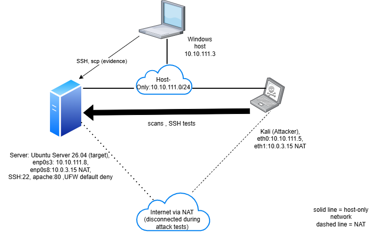

# Linux Server Security Lab

Hardening, attack simulation and threat detection on an isolated Ubuntu server.

## Objective
## Objective

I built an isolated lab with an Ubuntu web server and a Kali attacker machine. I secure the server, 
simulate real attacks against it (port scans and SSH brute force), detect them in the logs,
and measure the improvement with before/after evidence.
## Lab architecture

| Machine | OS | Role | IP |
|---|---|---|---|
| Server | Ubuntu Server 26.04 LTS | Target | 10.10.111.8 |
| Attacker | Kali Linux | Attack simulation | 10.10.111.5 |

<!-- Check the Kali address with `ip -br a` on Kali and write the one you actually see. -->

Network: VirtualBox host-only (10.10.111.0/24) for the lab, plus a NAT adapter on each VM for updates only (disconnected during attack tests).

## Threat model

(To write: who attacks, what they want, how. Map each simulated attack to a MITRE ATT&CK ID, for example T1110 Brute Force.)

## Results

| Metric | Before | After |
|---|---|---|
| Lynis hardening index | 60 | ? |
| Open TCP ports (full scan) | 2 (22, 80) | ? |
| SSH brute-force outcome | ? | ? |

Baseline details and raw evidence: [01-baseline](01-baseline/README.md)

## Phases

- [X] Phase 1: Baseline (November)
- [ ] Phase 2: Hardening (December)
- [ ] Phase 3: Attack simulation and detection (January)
- [ ] Phase 4: Final report (February)

## How to reproduce

Versions used: Ubuntu Server 26.04 LTS, Kali Linux, VirtualBox, Nmap 7.95, Nikto 2.5.0, Lynis 3.1.6.

(To complete: VM settings, network setup, order of steps.)

## Disclaimer

All attacks were performed only against my own virtual machines in an isolated network.
